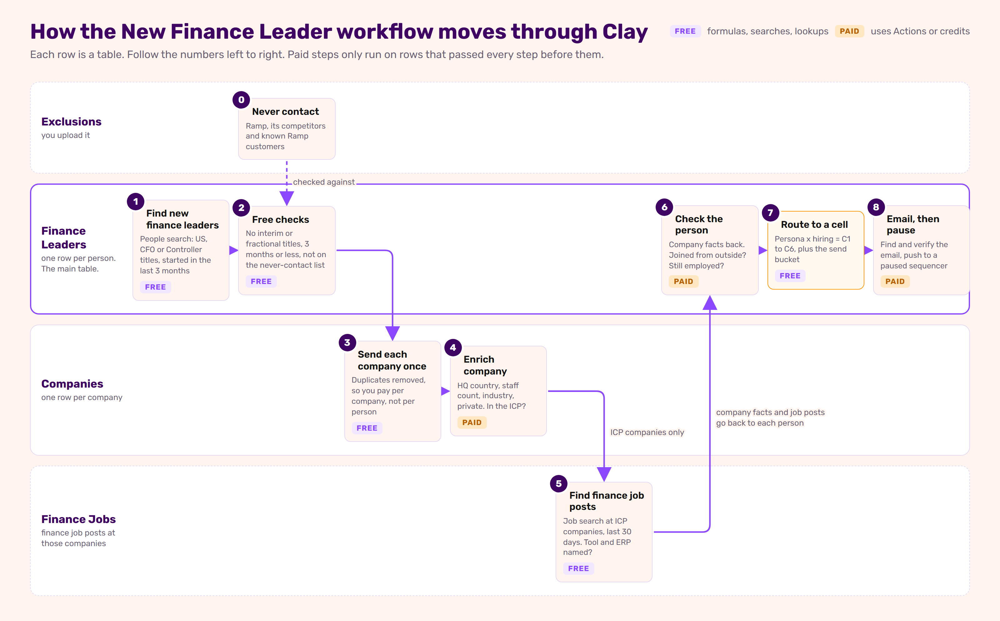

# Clay Build Guide: New Finance Leader, Software (Ramp portfolio build)

A step-by-step guide to building `workflow-spec.md` (in this folder) in Clay. Written for someone who has never built anything in Clay. Follow the parts in order. Each step tells you **why** it exists, **what to click**, **what to type**, **how to check it worked** and **what it costs**.

> **Don't skip the checks.** The most common Clay mistake is running a column on 500 rows before checking it worked on 1. Every step below ends with a check. If the check fails, fix it before moving on.

> **This is a portfolio build, not Ramp's own campaign.** Build the table, enrich it and prove it works. Don't send anything (see Part 12).

---

## Contents

- [What you are building](#what-you-are-building)
- [Clay words you need](#clay-words-you-need)
- [Before you start](#before-you-start)
- [Part 0. Set up the workbook](#part-0-set-up-the-workbook)
- [Part 1. Exclusions table](#part-1-exclusions-table)
- [Part 2. Find the new finance leaders](#part-2-find-the-new-finance-leaders)
- [Part 3. Free gates on each person](#part-3-free-gates-on-each-person)
- [Part 4. Companies table](#part-4-companies-table)
- [Part 5. Finance Jobs table (are they hiring?)](#part-5-finance-jobs-table)
- [Part 6. Bring company facts back to each person](#part-6-bring-company-facts-back-to-each-person)
- [Part 7. Check the person](#part-7-check-the-person)
- [Part 8. Route each person to a cell](#part-8-route-each-person-to-a-cell)
- [Part 9. Find and verify the work email](#part-9-find-and-verify-the-work-email)
- [Part 10. Copy variables (the email lines come later)](#part-10-copy-variables)
- [Part 11. Views for the operator](#part-11-views-for-the-operator)
- [Part 12. Connect the sequencer (build it, don't run it)](#part-12-connect-the-sequencer)
- [What it costs](#what-it-costs)
- [Final checklist](#final-checklist)
- [When something goes wrong](#when-something-goes-wrong)
- [Things the spec needs to fix](#things-the-spec-needs-to-fix)

---

## What you are building

The spec says: find a **new CFO, VP Finance, Head of Finance or Controller** at a US software, SaaS or AI company with 100 to 999 employees, who **joined from another company in the last 90 days**. Check the company fits, see whether it is hiring finance staff, sort each leader into one of **6 cells** (persona x hiring), and find their email. The copy is not written yet (spec status: copy pending), so this build stops at a clean, enriched, routed table.

You will build **4 tables** inside **1 workbook**:



Each row of the picture is a table. The numbers are the order you build in. Step 0 is the list you upload first.

Why this shape:
- **People first**, because the trigger is something that happened to a person (they started a new job).
- **Company checks happen once per company** in their own table. If two finance leaders at one company show up, you pay to enrich that company once.
- **Everything paid runs last**, and only on rows that passed every free check before it.

What a finished row in **Finance Leaders** looks like, reading left to right (made-up values):

| Person | Title | Company | Started | Days in role | ICP? | Finance roles open | Joined from | Persona | Hiring | Cell | Ready? | Email |
|---|---|---|---|---|---|---|---|---|---|---|---|---|
| Dana K. | VP Finance | Example Software Inc | 2026-09 | 60 | Yes | 2 | Other Co | ECONOMIC_BUYER | TEAM_BUILD | C3 | Yes | dana@example… |

---

## Clay words you need

| Word | What it means |
|---|---|
| **Workbook** | A folder of tables for one campaign. |
| **Table** | A spreadsheet. One row per company or per person. |
| **Source** | Where a table's rows come from (a Clay search, a CSV, another table). |
| **Column** | One piece of information per row. Three kinds matter: **plain** (you type or import it), **formula** (Clay calculates it, free), **enrichment / action** (Clay calls a data provider or AI, usually costs). |
| **Formula** | A small calculation, like a spreadsheet formula. Free. Clay has an AI helper: describe what you want in plain English and it writes the formula for you. |
| **Enrichment** | A column that looks something up (company size, a person's past jobs, an email). Costs **Actions**, and sometimes **Data Credits**. |
| **Lookup** | A column that reads a matching row from another table in your workbook. Free. |
| **Send table data** | A column that copies rows from this table into another table. Free. |
| **Run condition** ("Only run if") | A rule on a paid column: it only runs on rows where the rule is true. This is how you avoid paying for rows you'll throw away. |
| **Auto-run** | When on, new columns run on every row by themselves. **Keep it off** while building. |
| **Actions** | Clay's main usage meter. About 1 Action per enrichment per row. Unused Actions expire monthly. |
| **Data Credits** | A second meter, used when Clay pays a data provider for you (for example, email finders). |
| **View** | A saved filter on a table, like "only rows ready to send". |
| **Cell** (in this guide) | One of the spec's 6 routing boxes, C1 to C6. Not a spreadsheet cell. Where a spreadsheet cell is meant, the guide says "the cell in the table". |

---

## Before you start

Tick these off **before** you build.

- [ ] **Clay account** with access to the workspace you'll build in. Note which plan it's on (Settings → Plans & billing). You need enough Actions for roughly: companies + people + email lookups. See [What it costs](#what-it-costs).
- [ ] **Email finder connections** (Settings → Connections), if you'll use your own provider keys (for example Prospeo). Without your own keys, Clay uses its own and charges Data Credits.
- [ ] **The spec is open** next to you: `output/campaigns/new-finance-leader-software/workflow-spec.md`. Sections 2 (who's in and out), 4 (signals), 5 (cells) and 6 (variables) are what you're building.
- [ ] **The Exclusions CSV** is ready (Part 1 shows exactly what goes in it).
- [ ] **Test size: 25 people.** Your Week 2 deliverable needs at least 20 enriched records. Companies get enriched after the free gates (Part 4) and people after the company check (Part 7), so fewer than 25 will reach the paid steps. If fewer than 20 rows end up enriched, import another 25 from the same search and run the same columns on the new rows.

---

## Part 0. Set up the workbook

**Why:** one place for everything in this campaign, so anyone can find it and follow it.

1. In Clay, click **+ New** (top left) → **Workbook**.
2. Name it: `Ramp (portfolio) · New Finance Leader · Software`.
3. In the workbook description, paste: *"Signal: CFO, VP Finance, Head of Finance or Controller at a US software company (100 to 999 employees) who joined from another company in the last 90 days. Spec: ramp-gtm-os/output/campaigns/new-finance-leader-software/workflow-spec.md. Portfolio build: nothing is sent."*

**Check:** the workbook appears in your Clay home with that name.
**Cost:** free.

---

## Part 1. Exclusions table

**Why:** the spec (section 2, Exclude) lists who we must never contact: Ramp itself, Ramp's competitors (its 34-competitor versus list), Ramp customers and partner-sourced accounts. We put them in one table so every other table can check against it.

### 1.1 Make the CSV

Create a spreadsheet with **3 columns** and save it as `exclusions.csv`:

| Company Name | Domain | Type |
|---|---|---|
| Ramp | ramp.com | Self |
| Airbase | | Competitor |
| Airwallex | | Competitor |
| American Express | | Competitor |
| Bank of America | | Competitor |
| BILL (incl. BILL Spend & Expense, formerly Divvy) | | Competitor |
| Bluevine | | Competitor |
| Brex | | Competitor |
| Capital One | | Competitor |
| Center | | Competitor |
| Chase | | Competitor |
| Citi | | Competitor |
| Corpay | | Competitor |
| Coupa | | Competitor |
| Credit One | | Competitor |
| Expensify | | Competitor |
| Finvari | | Competitor |
| Melio | | Competitor |
| Mercury | | Competitor |
| Mesh | | Competitor |
| Navan | | Competitor |
| Navy Federal Credit Union | | Competitor |
| Novo | | Competitor |
| Relay | | Competitor |
| Rho | | Competitor |
| Rippling | | Competitor |
| SAP Concur | | Competitor |
| Slash | | Competitor |
| SVB | | Competitor |
| Teampay | | Competitor |
| U.S. Bank | | Competitor |
| Wells Fargo | | Competitor |
| Zip | | Competitor |

Then add the **software companies the research names as Ramp customers**, each with Type `Customer`: Notion, Perplexity, Mindbody, ClassPass, Vanta, Foursquare, ElevenLabs, Eventbrite, Sandboxx, Brandt Information Services, Webflow, FirstBlood, TaskHuman, Browserbase, Mode Analytics, WayUp, Bubble, Fi, Causal, Elementus, Clearbit, Crossbeam, Beyond, Crowdbotics, Apprentice.io, Quora, Advisor360, Cursor, Figma, Linear, Clay, Sierra, Harvey, Baseten, Arena, Open Router, Vercel, Groq, Cognition, Hex, Applied Compute, Legora, Cartesia, Serval, Elise AI, Brain Trust, Replit, Profound, Netic, Stripe, Shopify. (Source: `context/docs/research/customers.md`, sections 2 and 2.1. Some come from logo walls only; leaving a non-customer out of a portfolio build costs nothing.)

**Domain** is how every other table matches against this list, so fill it in for every row. Type it plain, the way Clay shows domains: `ramp.com`. No `https://`, no `www.`, no slash at the end. Find each one on the company's LinkedIn page or website, and check it's the company's own site, not a product or country subdomain. Only `ramp.com` is filled in above: the research doesn't record the others, so don't guess them.

> **Why domain and not name:** names clash. "Center", "Mesh", "Relay", "Zip" and "Arena" are also names of unrelated companies. A domain belongs to one company.

> **Partner-sourced accounts and open deals** (spec section 2) live in HubSpot, which you set up in Week 3. When you have a HubSpot export, add those companies to this same CSV with Type `CRM` and re-upload.

### 1.2 Upload it

1. Inside the workbook, click **+ Add table** → **Import CSV**.
2. Upload `exclusions.csv`. Name the table `Exclusions`.

**Check:** the row count matches your CSV, and there are 3 columns.
**Cost:** free.

---

## Part 2. Find the new finance leaders

**Why:** this is the trigger (spec section 1). Clay's people search can filter by job title, country, company size **and when they started the job**, all in one search. Searching and importing is **free**. You only pay later when you enrich.

### 2.1 Start a people search

1. In the workbook, click **+ Add table** → **Find people**.
2. You'll see a filter panel on the left and a preview of matching people on the right.

### 2.2 Set the filters

Fill in each filter exactly as below. These come straight from spec section 2.

| Filter | Set it to | Why |
|---|---|---|
| **Job title: include** (current job) | CFO · Chief Financial Officer · VP Finance · VP of Finance · SVP Finance · Head of Finance · Controller · Corporate Controller · VP Controller · Assistant Controller · VP of Accounting · Director of Accounting · Chief Accounting Officer | The 13 trigger titles |
| **Job title: exclude** | Interim · Fractional · Acting · Consultant · Advisor · Part-time · Outsourced | The spec's excluded words. Part 3 repeats this check as a formula, in case the search misses one |
| **Person location: country** | United States | US only |
| **Company size** | 51-200 · 201-500 · 501-1,000 | Spec says 100 to 999. Clay's buckets don't split at 100, so 51-200 lets in companies with 51 to 99 people. Part 4 drops them with a free formula after the real employee count comes in |
| **Company industry** | If your panel has an **include** option: Software Development · IT Services and IT Consulting · Technology, Information and Internet (these are the likely LinkedIn labels; check what the dropdown actually offers). If it only has **exclude**: exclude Government Administration · Non-profit Organizations · Staffing and Recruiting · Banking · Financial Services | Software, SaaS and AI only. Part 4 checks the industry again on the enriched company |
| **Started current role** (may be called "Time in current role" or "Job start date") | Within the last **3 months** | The heart of the trigger. Clay stores start dates as year and month, so "90 days" becomes "3 months or less". If your search panel doesn't show this filter, skip it: Part 3 has a free formula that does the same job |

### 2.3 Check the numbers before importing

Look at the **total count** above the preview. Write it down. Then switch the title filter to the economic-buyer titles only (CFO to Head of Finance), write that count, then the champion titles only (Controller to Chief Accounting Officer), and write that count.

| Search | Count |
|---|---|
| All 13 titles | ___ |
| Economic buyer titles (6) | ___ |
| Champion titles (7) | ___ |

**Why this matters:** this is the volume check, and it's free. The spec's signal matrix marks volume as unmeasured; these numbers replace that guess. Put all 13 titles back before importing.

### 2.4 Import

1. Set the import **limit to 25**.
2. Click **Import** (or **Save to table**). Name the table `Finance Leaders`.
3. **Turn Auto-run OFF**: open the table's settings (the ⚙ or "…" menu at the top of the table) → find **Auto-update / Auto-run** → off. Do this before adding any column.

### 2.5 Add the hidden fields

The search knows each person's **company domain** (e.g. `example.com`) and the **month they started** (e.g. `2026-09`), but doesn't always show them as columns.

1. Click any cell in the first column (the search source column). A panel opens showing everything the search returned for that person.
2. Find the company domain (inside the matched job, under company → domain). Click it → **Add as column**. Rename the column `Company Domain`.
3. Find the start date (inside the matched job → start_date). **Add as column**. Rename it `Start Date`.
4. Make sure `Job Title`, `Company`, `First Name`, `Full Name` and `LinkedIn Profile` are columns too. If one is missing, add it the same way.
5. Change `Company Domain` and `LinkedIn Profile` to type **URL** (column header → Edit column → Data type).

### 2.6 Remove duplicates

Table settings → **Deduplicate** → choose `LinkedIn Profile`. If one person appears twice, Clay keeps one.

**Check:** 25 rows. Each row has a name, job title, company, LinkedIn Profile, Company Domain and Start Date. Open 3 LinkedIn profiles and confirm they really are finance leaders who started recently.
**Cost:** free.

---

## Part 3. Free gates on each person

**Why:** drop the rows we know are wrong **before** spending anything. Every column here is a formula or a lookup (free).

**How to add a formula column:** click **+ Add column** (right end of the table) → **Formula**. You can type the formula, or click **Use AI** inside the formula box and describe it in plain English. When the formula refers to another column, type `/` and pick the column from the list. Below, columns are written as `{{Column Name}}`. Paste the plain-English line as the column description too, so anyone reading the table knows what it does.

### 3.1 `Title OK?`

Repeats the search's title exclusions, in case one slipped through.

- Plain English: *"True if the job title does not contain any of these whole words: interim, fractional, acting, consultant, advisor, part-time, part time, outsourced."*
- Formula:
```javascript
!/\b(interim|fractional|acting|consultant|advisor|part[- ]?time|outsourced)\b/i.test({{Job Title}} || "")
```
**Check:** "Interim CFO" → false. "Fractional Controller" → false. "VP Finance" → true. "Assistant Controller" → true.

### 3.2 `Days Since Start`

Start dates come as year and month. This counts days from the **15th** of the start month, so the answer is never more than about 15 days off.

- Plain English: *"Number of days between the 15th of the Start Date month (format YYYY-MM) and today, never below 0. Blank if Start Date is blank."*
- Formula:
```javascript
{{Start Date}} ? Math.max(0, Math.floor((Date.now() - new Date(Number({{Start Date}}.slice(0, 4)), Number({{Start Date}}.slice(5, 7)) - 1, 15).getTime()) / 86400000)) : null
```
**Check:** someone who started `2026-09` shows about 60 in mid-November 2026.

### 3.3 `Exclusion Match` (lookup)

1. **+ Add column** → search for **Lookup single row in other table**.
2. Table: `Exclusions`. Match column in Exclusions: `Domain`. Value from this table: `{{Company Domain}}`.
3. Save, then **run it on all rows** (lookups are free).

**Check:** temporarily add a row to `Exclusions` with the domain of one company in your Finance Leaders table. Its `Exclusion Match` should fill in. Then delete the test row.

### 3.4 `Pass Person Gates?`

- Plain English: *"True if Title OK is true, Days Since Start is not blank and is 90 or less, and Exclusion Match found nothing."*
- Formula:
```javascript
{{Title OK?}} === true && {{Days Since Start}} !== null && {{Days Since Start}} <= 90 && !{{Exclusion Match}}
```

> A blank start date fails here on purpose: the start date **is** the trigger, so a row without one can't be checked.

**Check:** sort by `Pass Person Gates?`. Open the "false" rows and make sure each one deserves to be out. If a good row is false, fix the formula, not the row.
**Cost:** free.

---

## Part 4. Companies table

**Why:** company facts (where it's headquartered, how many staff, what industry, public or private) are checked **once per company**. That's cheaper and cleaner than enriching the same company for every person.

### 4.1 Create the empty table

1. **+ Add table** → **Blank table**. Name it `Companies`.
2. Add two text columns: `Company Domain` (type URL) and `Company Name`.
3. Table settings → **Deduplicate** → choose `Company Domain`. Now, if two finance leaders work at the same company, the company appears only once.
4. Turn **Auto-run off** here too.

### 4.2 Send companies over from Finance Leaders

Back in `Finance Leaders`:

1. **+ Add column** → **Send table data** (sometimes listed as "Write to table").
2. Destination table: `Companies`.
3. Map: `Company Domain` → `{{Company Domain}}`, `Company Name` → `{{Company}}`.
4. **Run condition** ("Only run if"): `{{Pass Person Gates?}} === true`. Rows that failed Part 3 never reach Companies.
5. Run it on **1 row** first. Open `Companies` and check the company arrived with the right domain.
6. Then run on all rows.

**Check:** `Companies` has no more rows than people who passed Part 3, and no duplicates.
**Cost:** free.

### 4.3 Enrich each company

In `Companies`:

1. **+ Add column** → **Enrich Company** (Clay's company enrichment). Input: `{{Company Domain}}`.
2. Run it on **1 row only**. Click the cell in the table and read what came back.
3. From that cell, **Add as column** for: headquarters **country**, **employee count**, **industry**, company **type** (LinkedIn's label such as "Privately Held" or "Public Company"; may be called `type` or `company_type`) and the company **description**. Rename them `HQ Country`, `Employees`, `Industry`, `Company Type`, `Description`.
4. Check the 1 row against the company's LinkedIn page. Right country? Right size? Right industry?
5. If yes, run on the rest.

**Cost:** about **1 Action per company**. This is the first paid step.

### 4.4 Company formulas (free)

| Column | Plain English for the AI helper | Formula |
|---|---|---|
| `US HQ?` | True if HQ Country is the United States, written any common way | `/^(united states\|united states of america\|us\|usa)$/i.test(({{HQ Country}} \|\| "").trim())` |
| `Size OK?` | True if Employees is between 100 and 999 | `{{Employees}} >= 100 && {{Employees}} <= 999` |
| `Software?` | True if Industry is one of the software labels | `["Software Development","IT Services and IT Consulting","Technology, Information and Internet","Computer Software"].includes({{Industry}})` |
| `Private?` | False if Company Type says public company, nonprofit or government; true otherwise, including blank | `!/public company\|nonprofit\|non-profit\|government/i.test({{Company Type}} \|\| "")` |
| `ICP Pass?` | True if US HQ, Size OK, Software and Private are all true | `{{US HQ?}} === true && {{Size OK?}} === true && {{Software?}} === true && {{Private?}} === true` |

> **Why the HQ check matters:** the search in Part 2 filters on where the **person** is, not where the company is headquartered. A London company with a US finance lead would slip through. The HQ check catches it.

> **Software labels:** the four labels in `Software?` are the likely LinkedIn names. Before trusting the formula, filter `Software? = false` and read the `Industry` values. If a clearly software company shows a different label, add that label to the list. Companies dropped here are listed in the `Dropped` view (Part 11).

**Check:** pick 3 companies and confirm `ICP Pass?` by eye against LinkedIn.
**Cost:** free.

---

## Part 5. Finance Jobs table

**Why:** the spec routes on whether the company is **hiring finance staff** (spec section 4, signal 4), and reads the current tool and ERP from those job posts (signals 5 and 6). We search job posts only at companies that passed the ICP check.

### 5.1 Make a view of the companies that passed

In `Companies`, open the view dropdown at the top of the table → **+ New view**. Name it `ICP pass`. Add one filter: `ICP Pass?` = true.

### 5.2 Search their job posts

1. **+ Add table** → **Find jobs** (may be called "Jobs search" or "Find job postings"). At the top of the filters, choose to find jobs **at companies from a table** (may be called "Companies from table"). Pick table `Companies`, view `ICP pass`.
   > **Why a view and not pasted domains:** the search stays tied to the view, so it always searches exactly the companies that passed. Pasted domains are a snapshot: companies that qualify later never get searched.
2. Set:
   - **Job title: include**: Controller · Assistant Controller · Accounting Manager · Accounts Payable · AP Specialist · Staff Accountant · Revenue Accountant · Procurement Manager (spec section 4, signal 4)
   - **Date posted**: last **30 days**
3. Import. Name the table `Finance Jobs`. Turn **Auto-run off**.
4. From a source cell, **Add as column**: `Company Domain` (type URL), `Job Title` and `Job Description`.

> **If there is no Find jobs search in your workspace:** use the enrichment instead. In `Companies`, **+ Add column** → **Find Jobs at Company** (may be called "Company job openings"), input `{{Company Domain}}`, **run condition** `{{ICP Pass?}} === true`. That version is paid: about 1 Action per company. Prove it on 1 row first. Then skip 5.3 and point the formulas in 5.4 at that column instead.

### 5.3 Pull the jobs onto each company

In `Companies`: **+ Add column** → **Lookup multiple rows in other table** → table `Finance Jobs`, match `Company Domain` = `{{Company Domain}}`. Name it `Finance Jobs Found`. Run on all rows (free).

### 5.4 Company job formulas (free)

These are formulas so they can travel to `Finance Leaders` through the lookup in Part 6 (only formula columns cross a lookup cleanly). The field names inside `Finance Jobs Found` depend on what your lookup cell shows: open one cell, then let the AI helper write the formula from the plain English.

| Column | Plain English | Formula (adjust field names to your cell) |
|---|---|---|
| `Finance Job Titles` | All job titles in Finance Jobs Found, joined with " \| " | `({{Finance Jobs Found}} \|\| []).map(j => j?.["Job Title"] \|\| "").filter(t => t).join(" \| ")` |
| `Job Text` | All job descriptions in Finance Jobs Found, joined, lowercase | `({{Finance Jobs Found}} \|\| []).map(j => j?.["Job Description"] \|\| "").join(" ").toLowerCase()` |
| `Incumbent Tool` | The first of these names found in Job Text: Expensify, SAP Concur, Bill.com, Divvy, Brex, Navan, Coupa, Amex. Blank if none | `["Expensify","SAP Concur","Bill.com","Divvy","Brex","Navan","Coupa","Amex"].find(t => ({{Job Text}} \|\| "").includes(t.toLowerCase())) \|\| ""` |
| `ERP` | The first of these names found in Job Text: NetSuite, Sage Intacct, QuickBooks, Xero, Rillet, Campfire. Blank if none | `["NetSuite","Sage Intacct","QuickBooks","Xero","Rillet","Campfire"].find(t => ({{Job Text}} \|\| "").includes(t.toLowerCase())) \|\| ""` |
| `ERP Excluded?` | True if Job Text contains the whole word sap, oracle or workday | `/\b(sap\|oracle\|workday)\b/.test({{Job Text}} \|\| "")` |
| `ICP Final?` | True if ICP Pass is true and ERP Excluded is not true | `{{ICP Pass?}} === true && {{ERP Excluded?}} !== true` |

> **Watch `ERP Excluded?`:** "workday" is also an ordinary word ("each workday"). Filter `ERP Excluded? = true` and read the job text for each one. If it's the ordinary word, the company is wrongly dropped: see [Things the spec needs to fix](#things-the-spec-needs-to-fix), item 6.

**Check:** pick one company with job posts. Open its LinkedIn Jobs page. Do the titles match `Finance Job Titles`? If the job text names a tool, is it in `Incumbent Tool`?
**Cost:** the job search is free like other searches (check the cost Clay shows before importing). The fallback enrichment is about 1 Action per ICP-pass company.

---

## Part 6. Bring company facts back to each person

### 6.1 Count leaders per company

The spec contacts **one leader per company**. If two leaders at one company pass, you'll pick one by hand (Part 8.7).

In `Companies`:
1. **+ Add column** → **Lookup multiple rows in other table** → table `Finance Leaders`, match `Company Domain` = `{{Company Domain}}`. Name it `Leaders Found`.
2. Formula `Leaders Count`: *"number of rows in Leaders Found where Pass Person Gates is true"*:
```javascript
({{Leaders Found}} || []).filter(p => p?.["Pass Person Gates?"] === true).length
```

### 6.2 Look the company up from each person

In `Finance Leaders`:

1. **+ Add column** → **Lookup single row in other table** → table `Companies`, match `Company Domain` = `{{Company Domain}}`. Name it `Company Facts`.
2. From one cell in the table, **Add as column**: `ICP Final?`, `Finance Job Titles`, `Incumbent Tool`, `ERP`, `Leaders Count`.

**Check:** a person at a company you checked in Part 4 shows the same values.
**Cost:** free.

---

## Part 7. Check the person

### 7.1 Find where they worked before (`Enrich Person`)

**Why:** the spec only wants leaders who **joined from another company** (spec section 1: no internal promotions in v1).

1. **+ Add column** → **Enrich Person** (from LinkedIn profile). Input: `{{LinkedIn Profile}}`.
2. **Run condition:** `{{Pass Person Gates?}} === true && {{ICP Final?}} === true`. Don't pay to enrich people at companies that already failed.
3. Run on **1 row**. Open the cell in the table and find the **list of past jobs** (often called `experience` or `experiences`). Note which field holds the company name and which holds the company domain or LinkedIn URL.

### 7.2 `Previous Company` and `Previous Domain`

Use the AI formula helper. Plain English: *"From the Enrich Person result, take the most recent job that is not the current job. Return its company name."* Then the same for its domain.

The formula will look roughly like this. **The field names depend on what your Enrich Person cell shows, so let the AI helper write it from the real cell:**
```javascript
{{Enrich Person}}?.experience?.find(e => !e.is_current)?.company_name || ""
```

### 7.3 `Joined From Outside?`

- Plain English: *"True if Previous Company is not empty and Previous Domain is different from Company Domain."*
```javascript
!!{{Previous Company}} && {{Previous Domain}} !== {{Company Domain}}
```

> Internal promotions (`Joined From Outside?` false) stay in the table. The spec logs them for a later test (spec section 1).

### 7.4 `Still Employed?`

**Why:** search data can lag. One AI check confirms they still hold the job before anyone contacts them. Downstream, only an exact `YES` passes.

1. **+ Add column** → **Use AI**.
2. Prompt:
   > *"Here is a person's work history: {{Enrich Person}}. Are they currently employed at the company with domain {{Company Domain}} as {{Job Title}} or a similar finance leadership title? Answer YES, NO or REVIEW (REVIEW if the evidence is unclear). Give one short piece of evidence from the work history."*
3. Output format: **JSON**, with exactly these fields:
   - `response`: text, must be one of `YES`, `NO`, `REVIEW`
   - `evidence`: text
4. **Run condition:** `{{Joined From Outside?}} === true`
5. Run on **2 rows you can judge yourself**: read both answers against LinkedIn. If one is wrong, fix the prompt and re-run the same 2. Then run the rest.

> **REVIEW counts as not ready.** A REVIEW row lands in the `Review` view (Part 11) for a person to check by hand.

**Cost:** Enrich Person about **1 Action per person**. Use AI about **1 Action plus a small AI cost per person**.

---

## Part 8. Route each person to a cell

All formulas, all free. They implement spec sections 4, 5 and 7.

### 8.1 `Leader Persona`

- **Plain English:** *"ECONOMIC_BUYER if the job title is CFO, Chief Financial Officer, VP Finance, VP of Finance, SVP Finance or Head of Finance. Otherwise CHAMPION if it contains Controller, VP of Accounting, Director of Accounting or Chief Accounting Officer. Otherwise blank."*
- **Formula:**
```javascript
/\bcfo\b|chief financial officer|\b(s?vp),? (of )?finance\b|head of finance/i.test({{Job Title}} || "") ? "ECONOMIC_BUYER"
: /controller|vp,? (of )?accounting|director of accounting|chief accounting officer/i.test({{Job Title}} || "") ? "CHAMPION"
: ""
```
- **Check:** "VP Finance" → ECONOMIC_BUYER. "Corporate Controller" → CHAMPION. "Chief Accounting Officer" → CHAMPION.

### 8.2 `Finance Roles Open`

Counts the company's finance job posts, **leaving out posts in the leader's own title family** (spec signal 4: likely the stale post for the role they just filled). For a CHAMPION, that means any title containing "controller".

- **Plain English:** *"Split Finance Job Titles on ' | '. Count the titles that are not empty, leaving out any title containing 'controller' when Leader Persona is CHAMPION."*
- **Formula:**
```javascript
({{Finance Job Titles}} || "").split(" | ").filter(t => t && !({{Leader Persona}} === "CHAMPION" && /controller/i.test(t))).length
```

### 8.3 `First Role Title`

- **Plain English:** *"The first title that Finance Roles Open counted. Blank if none."*
- **Formula:**
```javascript
({{Finance Job Titles}} || "").split(" | ").filter(t => t && !({{Leader Persona}} === "CHAMPION" && /controller/i.test(t)))[0] || ""
```

### 8.4 `Hiring Cluster`

- **Plain English:** *"NOT_HIRING if Finance Roles Open is 0, ONE_ROLE if it is 1, TEAM_BUILD if it is 2 or more."*
```javascript
{{Finance Roles Open}} >= 2 ? "TEAM_BUILD" : {{Finance Roles Open}} === 1 ? "ONE_ROLE" : "NOT_HIRING"
```

### 8.5 `Cell`

The spec's 6 cells are persona x hiring.

- **Plain English:** *"For ECONOMIC_BUYER: C1 if NOT_HIRING, C2 if ONE_ROLE, C3 if TEAM_BUILD. For CHAMPION: C4 if NOT_HIRING, C5 if ONE_ROLE, C6 if TEAM_BUILD. Blank if Leader Persona is blank."*
```javascript
({"ECONOMIC_BUYER": {"NOT_HIRING": "C1", "ONE_ROLE": "C2", "TEAM_BUILD": "C3"}, "CHAMPION": {"NOT_HIRING": "C4", "ONE_ROLE": "C5", "TEAM_BUILD": "C6"}})[{{Leader Persona}}]?.[{{Hiring Cluster}}] || ""
```
**Check:** filter by each cell and read 1 row per cell. Does the title match the persona, and the job posts match the hiring cluster?

### 8.6 The timing test: `Start Bucket`, `Send Bucket`, `Send Now?`

The spec (section 7) tests whether contacting a leader in their first, second or third month works best.

| Column | Kind | Plain English | Formula |
|---|---|---|---|
| `Start Bucket` | Formula | FIRST_MONTH if Days Since Start is 30 or less, SECOND_MONTH if 31 to 60, THIRD_MONTH if more | `{{Days Since Start}} <= 30 ? "FIRST_MONTH" : {{Days Since Start}} <= 60 ? "SECOND_MONTH" : "THIRD_MONTH"` |
| `Send Bucket` | Formula | Add up the character codes of LinkedIn Profile, divide by 3, keep the remainder (0, 1 or 2) | `({{LinkedIn Profile}} \|\| "").split("").reduce((a, c) => a + c.charCodeAt(0), 0) % 3` |
| `Backlog Run` | **Plain checkbox** | Tick it for every row from this first import. Leave it blank for rows from later monthly runs | (no formula) |
| `Send Now?` | Formula | True if Backlog Run is ticked, or the leader's current bucket (0 first month, 1 second, 2 third) has reached their Send Bucket | `{{Backlog Run}} === true \|\| ({"FIRST_MONTH": 0, "SECOND_MONTH": 1, "THIRD_MONTH": 2})[{{Start Bucket}}] >= {{Send Bucket}}` |
| `Late?` | Formula | True if not a backlog row and the current bucket is past the Send Bucket | `{{Backlog Run}} !== true && ({"FIRST_MONTH": 0, "SECOND_MONTH": 1, "THIRD_MONTH": 2})[{{Start Bucket}}] > {{Send Bucket}}` |

> **Why a checkbox for the first run:** the spec says the first run clears the backlog, so everyone in it is sent at once. From the second run on, each leader waits for their send bucket. Avoid `new Set` and `...` in these formulas: Clay returns empty results silently.

**Check:** the 25 rows should split roughly evenly across Send Bucket 0, 1 and 2. All first-import rows show `Send Now?` true because `Backlog Run` is ticked.

### 8.7 `Chosen Leader` and `Ready to Contact?`

1. Add a **plain checkbox** column `Chosen Leader`. Only use it where `Leaders Count` is 2 or more: tick the one leader to contact at that company (see spec fix 4).
2. Formula `Ready to Contact?`. Every check from the spec in one column. Only rows with **true** get an email lookup.

- Plain English: *"True if all of these are true: Pass Person Gates, ICP Final, Joined From Outside, Still Employed is YES, Cell is not blank, Send Now, and either Leaders Count is 1 or Chosen Leader is ticked."*
```javascript
{{Pass Person Gates?}} === true && {{ICP Final?}} === true && {{Joined From Outside?}} === true && {{Still Employed?}}?.response === "YES" && !!{{Cell}} && {{Send Now?}} === true && ({{Leaders Count}} === 1 || {{Chosen Leader}} === true)
```

**Check:** filter `Ready to Contact? = true`. Open every row. Would you be happy for each of these people to get the email?
**Cost:** free.

---

## Part 9. Find and verify the work email

**Why:** we only look up emails for people we would actually contact. This is usually the most expensive step.

1. **+ Add column** → **Find work email** (Clay's email **waterfall**: it tries several providers in order until one finds an email).
2. Inputs: full name `{{Full Name}}`, company domain `{{Company Domain}}`, LinkedIn `{{LinkedIn Profile}}`.
3. Providers: put any you've connected with your own key first, then Clay's. The spec lists Prospeo, LeadMagic, Icypeas, Findymail. **4 providers is enough.**
4. Turn on **validation** inside the waterfall (each email found is checked before it's accepted). Choose the strict setting: **don't accept "catch-all" or "risky"**.
5. **Run condition:** `{{Ready to Contact?}} === true`.
6. Run on **1 row**. Read the result: an email, plus a status such as "valid".
7. Then run on the rest of the `Ready to Contact?` rows.
8. From the waterfall, **Add as column**: `Work Email` (type Email) and `Email Status`.
9. Formula `LinkedIn Only?`: *"True if Ready to Contact is true and Email Status is not valid"*: `{{Ready to Contact?}} === true && {{Email Status}} !== "valid"`. The spec sends these people LinkedIn steps only.

**Check:** every row with an email has status valid, and the email's domain matches `Company Domain`. Rows with no valid email show `LinkedIn Only?` true.
**Cost:** Actions plus Data Credits **for each provider step that actually runs**. A row found by the first provider costs less than one that goes through all four.

---

## Part 10. Copy variables

**Why:** the spec's copy isn't written yet (status: copy pending). `/campaign-copy` writes it next, and the email lines become formula columns here afterwards. What you can build now are the **variables** the spec's contract allows (spec section 6), so the copy has clean inputs.

All formulas, all free. Each only needs to work on `Ready to Contact?` rows.

| Column | Spec variable | Plain English | Formula |
|---|---|---|---|
| `Company Short` | `{{company_name}}` | Company name without Inc, LLC, Ltd, Corp | `({{Company}} \|\| "").replace(/,?\s+(inc\|llc\|ltd\|corp\|corporation)\.?$/i, "").trim()` |
| `Start Month` | `{{start_month}}` | Month name of Start Date, e.g. "September" | `["January","February","March","April","May","June","July","August","September","October","November","December"][Number(({{Start Date}} \|\| "").slice(5, 7)) - 1] \|\| ""` |
| `Role Title` | `{{role_title}}` | First Role Title, only in the hiring cells C2, C3, C5, C6; blank otherwise | `["C2","C3","C5","C6"].includes({{Cell}}) ? {{First Role Title}} : ""` |
| `Proof Customer` | `{{social_proof}}` (which story) | Foursquare for C1 and C6, Brandt for C2 and C5, TaskHuman for C3, Perplexity for C4 | `({"C1": "Foursquare", "C2": "Brandt", "C3": "TaskHuman", "C4": "Perplexity", "C5": "Brandt", "C6": "Foursquare"})[{{Cell}}] \|\| ""` |

The other variables already exist as columns: `{{first_name}}` = `First Name`, `{{leader_title}}` = `Job Title`, `{{start_bucket}}` = `Start Bucket`, `{{incumbent_tool}}` = `Incumbent Tool`, `{{erp}}` = `ERP`. `{{sender_name}}` comes from `context/messaging/facts.md` ("Demo sender (portfolio project)") and goes in the sequencer signature, not in Clay.

> `Incumbent Tool` and `ERP` may only be used in the hiring cells (spec branch coverage). C1 and C4 rows can have a value from the company's job text but must not use it.

**Check:** one row per cell. Is `Role Title` blank in C1 and C4? Does `Proof Customer` match the table above?
**Cost:** free.

---

## Part 11. Views for the operator

**Why:** someone opening this table later should see what matters without understanding every column.

In `Finance Leaders`, create these views (**+ View** or the view dropdown at the top → add a filter):

| View | Filter | Who uses it |
|---|---|---|
| `Ready to send` | `Ready to Contact?` = true AND `Email Status` = valid | The person loading the sequencer |
| `LinkedIn only` | `LinkedIn Only?` = true | The rep doing LinkedIn steps |
| `Waiting for send bucket` | `ICP Final?` = true AND `Send Now?` = false | Next monthly run |
| `Pick one leader` | `Leaders Count` >= 2 AND `Pass Person Gates?` = true | Whoever ticks `Chosen Leader` |
| `Review` | `Still Employed?` response is REVIEW | Hand check against LinkedIn |
| `Promotions (logged)` | `Joined From Outside?` = false | Spec's later promotion test |
| `Dropped` | `Pass Person Gates?` = false OR `ICP Final?` = false | Spot-checking the gates |

In the `Ready to send` view, hide helper formulas (Days Since Start, Finance Job Titles, Send Bucket…) and keep: name, title, company, cell, persona, hiring cluster, email, and the Part 10 variables. **Don't hide paid columns or lookups**: they show where the data came from.

---

## Part 12. Connect the sequencer

**Build this column, but don't run it.** The spec can't send: the copy is pending, the sequencer isn't chosen (Instantly is proposed in `context/docs/gtm-system.md`), and this is a portfolio build that must never send under Ramp's name.

1. In the sequencer, create a campaign called `New Finance Leader · Software · v1`, and **leave it paused**. The template stays empty until `/campaign-copy` delivers approved copy.
2. In `Finance Leaders`: **+ Add column** → the sequencer's "Add lead to campaign" action.
3. Map: email `{{Work Email}}`, first name `{{First Name}}`, company `{{Company Short}}`, and custom fields `leader_title`, `start_month`, `start_bucket`, `role_title`, `incumbent_tool`, `erp`, `cell`, `proof_customer` → the matching columns.
4. **Run condition:** `{{Ready to Contact?}} === true && {{Email Status}} === "valid"`.
5. **Stop.** Don't run it.

LinkedIn steps (spec section 7) become tasks for a rep once HubSpot is set up in Week 3. The `LinkedIn only` view is their list.

**Cost:** about **1 Action per lead pushed**, when it is eventually run. Nothing now.

---

## What it costs

Free: the people search, the job search (check the cost Clay shows), imports, formulas, lookups, Send table data, views.

Paid, and only on rows that passed every check before it:

| Step | Runs on | Rough cost |
|---|---|---|
| Enrich Company (4.3) | Each company that passed the person gates | About 1 Action per company |
| Find Jobs at Company (5.2 fallback only) | ICP-pass companies, only if there's no free job search | About 1 Action per company |
| Enrich Person (7.1) | People at ICP-final companies | About 1 Action per person |
| Still Employed? (7.4) | People who joined from outside | About 1 Action + a small AI cost per person |
| Email waterfall (9) | `Ready to Contact?` rows only | Actions + Data Credits per provider step that runs |
| Sequencer push (12) | Not run in this build | About 1 Action per lead, later |

**Example for the 25-person test (made-up numbers, to show the arithmetic):** say 20 people pass Part 3 at 19 companies, 11 companies pass the ICP check, so 11 people get Enrich Person, 9 joined from outside, and 8 end `Ready to Contact?`. That's about 19 (Enrich Company) + 11 (Enrich Person) + 9 (Still Employed) + (8 x 1 to 4 waterfall steps) ≈ **47 to 71 Actions**, plus some Data Credits for emails. Add about 11 if you need the paid job enrichment.

> **For the Week 2 deliverable (20+ enriched records):** in this example, 19 companies get enriched but only 11 people do. If you need 20 enriched **people**, import more leaders (about 50) and run the same columns on the new rows.

Watch the Actions counter (top of Clay) before and after each paid step, and write the numbers down. That's your real cost per row.

---

## Final checklist

- [ ] Auto-run is **off** on every table.
- [ ] Every paid column has a **run condition**.
- [ ] Every paid column was tested on **1 row** (AI columns: 2 rows you judged yourself) and the cell was read before running more.
- [ ] `Companies` has no duplicate domains.
- [ ] No company from `Exclusions` appears in `Ready to send`.
- [ ] Every `Ready to Contact?` row has `Still Employed?` = YES and a cell.
- [ ] Every company with 2+ passing leaders has exactly one `Chosen Leader` ticked.
- [ ] `ERP Excluded?` true rows were read by hand (the "workday" problem).
- [ ] Copy variables checked on one row per cell.
- [ ] Sequencer campaign exists, **paused**, push column built and **not run**.
- [ ] Actions spent are written down per step.
- [ ] The search counts from Part 2.3 are written down (they replace the spec's unmeasured volume).

---

## When something goes wrong

| What you see | Likely cause | Fix |
|---|---|---|
| Search shows 0 people | A filter is too strict (often the start-date filter or the industry filter) | Remove filters one at a time to find which one empties it |
| Thousands of people from everywhere | The country or start-date filter didn't apply | Re-check filters before importing; the Part 3 formula gate still catches them |
| A column ran on every row and spent Actions | Auto-run was on, or no run condition | Turn auto-run off; add the run condition; you can't get Actions back, so note the spend |
| Formula shows an error | A column name changed, or a value is blank | Re-pick the column with `/`; guard blanks with `\|\| ""` |
| Lookup finds nothing | The two domains are written differently (`www.example.com` vs `example.com`) | Compare the two values side by side. Retype the domain plain, or add a formula that strips `https://`, `www.` and the trailing `/` before matching |
| Many software companies fail `Software?` | Their LinkedIn industry label isn't in the list | Read the `Industry` values in the `Dropped` view and add the missing labels to the formula |
| `Finance Job Titles` always blank | The field names in the lookup formula don't match your cell | Open a `Finance Jobs Found` cell and point the formula at the real field names |
| `Previous Company` is blank | The person's LinkedIn has one job only, or the field name in your formula is wrong | Open the Enrich Person cell and point the formula at the real field |
| `Send Now?` false on first-import rows | `Backlog Run` isn't ticked | Tick `Backlog Run` for every first-import row |
| Email status is "catch-all" or "risky" | The company's mail server accepts everything | Leave it out. The row goes to `LinkedIn only` |
| Same company twice in Companies | Deduplicate wasn't set before the first send | Set dedupe on `Company Domain`, then delete the duplicates |

---

## Things the spec needs to fix

Found while writing this guide. Update `workflow-spec.md` (and re-approve it):

1. **Section 1 and 4 (start window and buckets):** Clay gives start dates as year and month only, so "0 to 90 days" becomes "3 months or less" in the search, and `Days Since Start` is counted from the 15th of the month (up to about 15 days off). The 30/60/90-day buckets are approximate. Say so in the spec.
2. **Section 2 (size):** Clay's company size buckets don't split at 100. The search uses 51-200, 201-500 and 501-1,000, and the 100 to 999 band is enforced after Enrich Company. No change to the band, just note where it's enforced.
3. **Section 2 (industry):** the spec says "software, SaaS and AI companies" but doesn't name the LinkedIn industry labels that count. The guide uses Software Development, IT Services and IT Consulting, Technology, Information and Internet, and Computer Software. Name them in the spec, or add an AI classification for companies with other labels (AI companies are often labelled differently).
4. **Section 2 (one contact per company):** the spec doesn't say which leader wins when two qualify at the same company. The guide holds them for a hand pick (`Chosen Leader`). Suggested rule: the most recent start date wins; on a tie, the economic buyer.
5. **Section 4, signal 5 (incumbent tool):** job posts often say just "Concur", not "SAP Concur", but "concur" also appears inside ordinary words ("concurrent"). Decide whether to match "Concur" as a whole word.
6. **Section 4, signal 6 (ERP exclusion):** "workday" is also an ordinary word, so a whole-word match on "Workday" can wrongly exclude a company. Suggest matching "Workday Financials" or "Workday ERP", or reviewing exclusions by hand.
7. **Section 4, signals 5 and 6:** the tool and ERP are read from **all** the company's finance job posts, including the leader's own stale post, which signal 4 leaves out of the count. Say whether that's intended.
8. **Section 7 (first run):** the spec says the first run clears the backlog. The guide implements it with a `Backlog Run` checkbox ticked on the first import only. Write that into the spec.
9. **Section 2 (exclusions):** partner-sourced accounts, open opportunities and recent losses need HubSpot, which doesn't exist until Week 3. Until then the Exclusions table holds Ramp, its competitors and research-named customers only.
10. **Section 7 (channel):** the sequencer and LinkedIn tool aren't chosen, so the send layer is built and paused. Update the spec when they're chosen.
